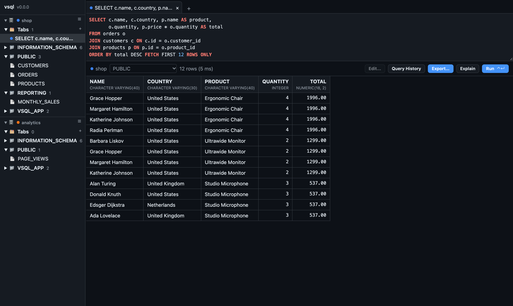
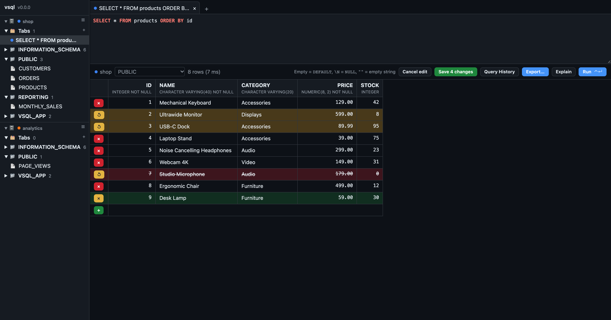
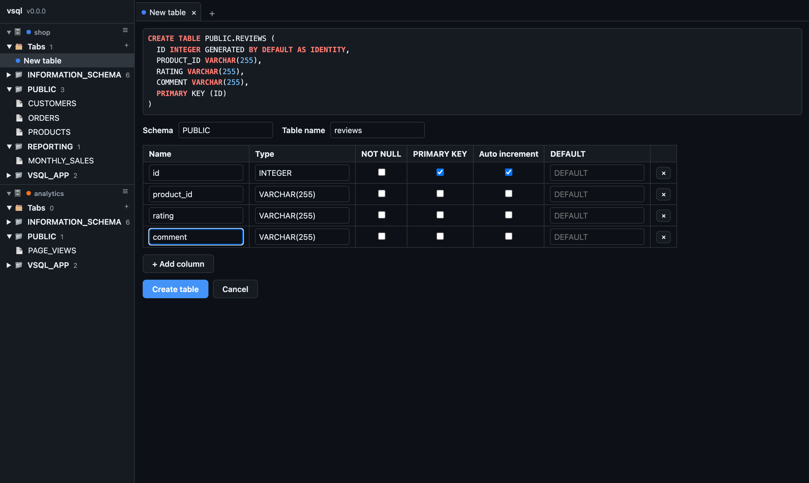
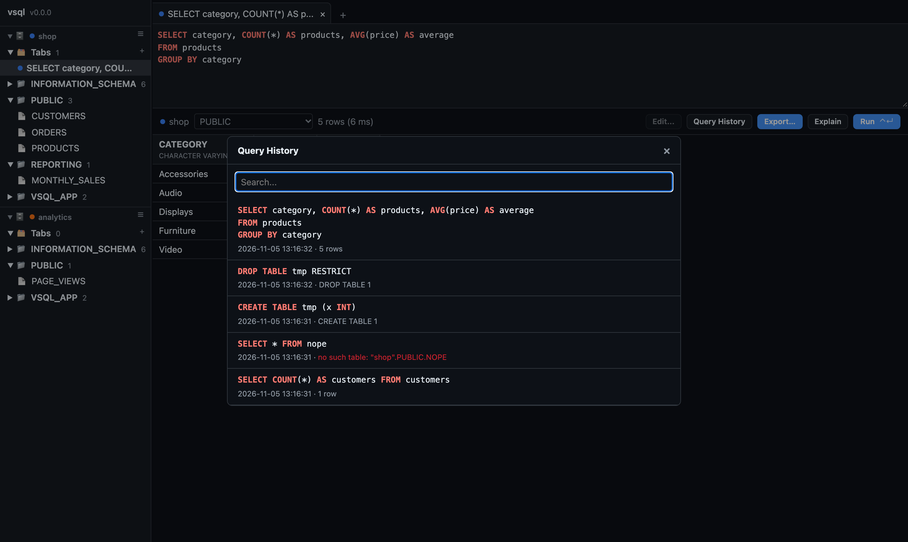
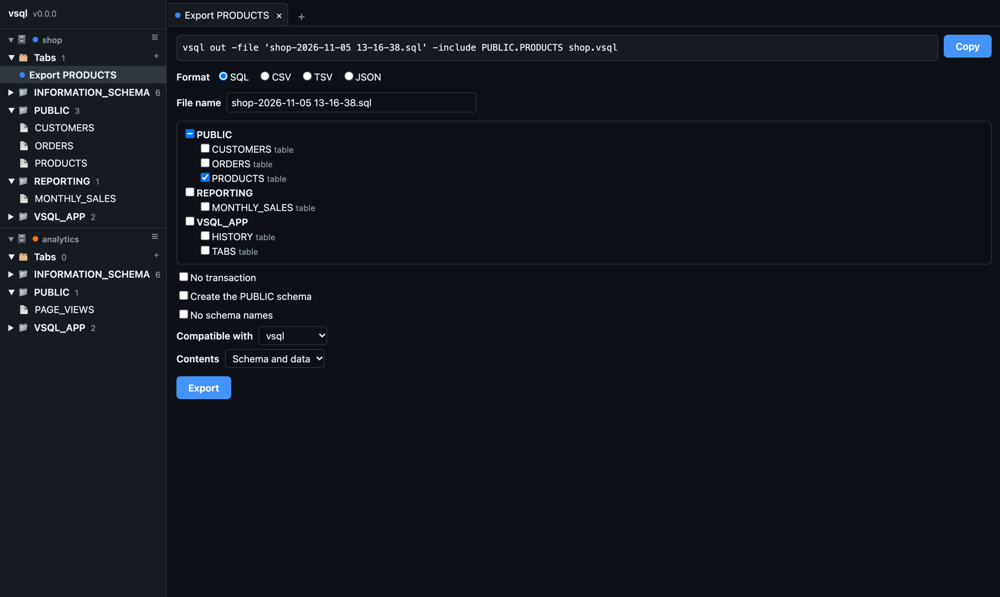
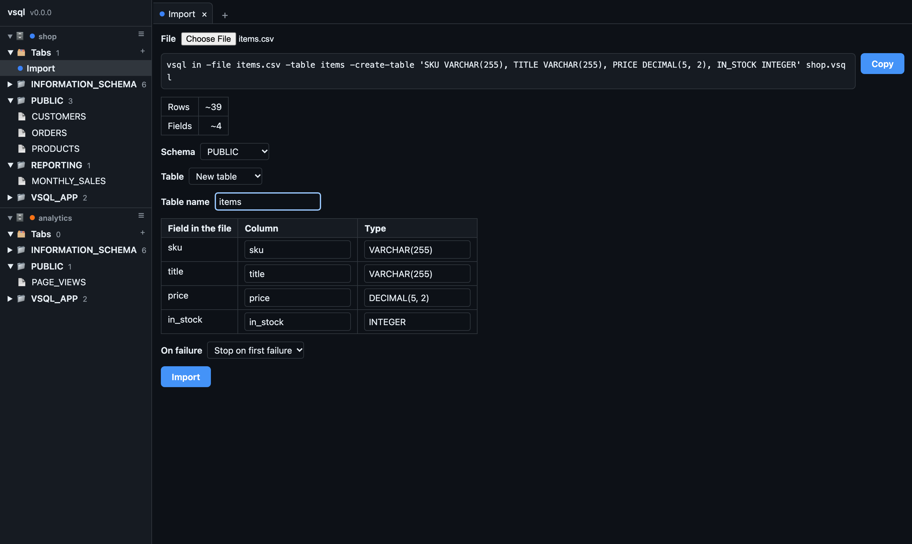

✌️ vsql
======

[](https://github.com/elliotchance/vsql/releases)
[](https://vsql.readthedocs.io/)
[](https://discord.com/channels/592103645835821068/1168743197619531856)

**vsql is an embedded SQL database that follows the SQL standard.** A whole
database lives in a single file (or in memory), with real transactions, strict
types and standard SQL. Embed it in your program from [V](https://vsql.readthedocs.io/en/latest/language-v.html),
[C](https://vsql.readthedocs.io/en/latest/language-c.html), [Go](https://github.com/elliotchance/vsql-go), [Python](https://github.com/elliotchance/vsql-python),
[Java](https://github.com/elliotchance/vsql-java), [Rust](https://github.com/elliotchance/vsql-rust) or [Node.js](https://github.com/elliotchance/vsql-node),
connect to it with any [PostgreSQL client](https://vsql.readthedocs.io/en/latest/server.html), or browse it in
your browser. It's a single binary written in pure V, with nothing else to install.

```text
$ vsql cli shop.vsql
vsql> CREATE TABLE products (name VARCHAR(50), price NUMERIC(10, 2));
CREATE TABLE 1 (0 ms)

vsql> INSERT INTO products (name, price) VALUES ('Coffee', 4.50), ('Bagel', 2.25);
INSERT 2 (1 ms)

vsql> SELECT * FROM products ORDER BY name;
NAME   | PRICE
-------+------
Bagel  |  2.25
Coffee |  4.50
2 rows (1 ms)
```

Why vsql?
---------

- **Standard SQL.** vsql follows the SQL:2016 standard rather than one
  database's dialect, so your queries, your skills and your schema carry over
  to other databases. Errors have the standard SQLSTATE codes, and the
  [compliance tables](https://vsql.readthedocs.io/en/latest/sql-compliance.html)
  list exactly what's supported.
- **A complete SQL database.** Joins, subqueries, aggregates, indexes,
  `PRIMARY KEY`, `UNIQUE`, `FOREIGN KEY` and `CHECK` constraints, sequences
  and identity columns, cursors, `ALTER TABLE`, and the standard
  `INFORMATION_SCHEMA` views.
- **Transactions you can rely on.** `SERIALIZABLE` by default, with all four
  standard isolation levels, built on
  [MVCC](https://vsql.readthedocs.io/en/latest/mvcc.html). Connections in
  different processes can share a file, and a write-ahead log keeps it safe if
  the process crashes or the power fails.
- **One file, no server.** Copy, back up or email a database like any other
  file, or use `:memory:` for one that only lives in memory.
- **Every way you need it.** A library for
  [seven languages](#use-it-from-your-language), a CLI, a
  [PostgreSQL-compatible server](https://vsql.readthedocs.io/en/latest/server.html),
  and a [browser app](#vsql-app) for exploring your data.

vsql or SQLite?
---------------

SQLite is a great database, and vsql is just as easy to use: one file, no
server and no setup. The difference is that vsql behaves like a "real" SQL
database, so you won't find problems for the first time in production:

| | vsql | SQLite |
|---|---|---|
| **Types** | Strict. Putting text in an `INTEGER` column is an error. | Any column can hold any value (unless the table is `STRICT`). |
| **Exact numbers** | [`NUMERIC` and `DECIMAL`](https://vsql.readthedocs.io/en/latest/numbers.html) are exact, so money adds up to the cent. | Fractions are stored as floating point. |
| **Dates and times** | [`DATE`, `TIME` and `TIMESTAMP`](https://vsql.readthedocs.io/en/latest/dates-times.html), with or without a time zone. | Stored as text or numbers. |
| **SQL dialect** | The [SQL standard](https://vsql.readthedocs.io/en/latest/sql-compliance.html), the same as PostgreSQL and most other databases follow. | SQLite's own dialect. |
| **Many connections** | Many connections, in the same process or in different processes, can use a file at once. A transaction only locks the file while each of its statements runs ([MVCC](https://vsql.readthedocs.io/en/latest/mvcc.html)), so readers and writers don't hold each other up. | A write transaction locks the whole file until it ends, so other connections are blocked or fail with "database is locked". |
| **Transactions** | All four standard [isolation levels](https://vsql.readthedocs.io/en/latest/transactions.html#isolation-levels), with `SERIALIZABLE` by default. | Only serializable. |
| **Changing tables** | [`ALTER TABLE`](https://vsql.readthedocs.io/en/latest/alter-table.html) adds and drops columns and constraints, and changes defaults. | Many changes need the table to be rebuilt. |
| **Errors** | Standard [SQLSTATE](https://vsql.readthedocs.io/en/latest/sqlstate.html) codes, such as `23505` for a duplicate key. | SQLite's own result codes. |
| **Describing the database** | The standard [`INFORMATION_SCHEMA`](https://vsql.readthedocs.io/en/latest/information-schema.html) views. | `sqlite_schema` and `PRAGMA`s. |

That makes vsql a good fit for:

- **Testing applications that use PostgreSQL (or another SQL database) in
  production.** Get the speed and simplicity of an embedded database in your
  tests, without the surprises of a database that accepts things yours won't.
- **Applications with many connections**, such as a web server with a
  connection pool, or several processes and background workers that share one
  database file.
- **Applications that care about correctness**, such as anything that handles
  money, stock levels or bookings.
- **Learning and teaching SQL**, since everything you learn works elsewhere.

**Performance on disk is on par with SQLite.** With a database file of 100,000
accounts on an Apple M-series Mac, vsql runs about 1,350 TPC-B transactions per
second, and inserts about 9,000 rows per second while it sets the file up. Run
`vsql bench` to measure it on your own machine (see
[Benchmark](https://vsql.readthedocs.io/en/latest/benchmark.html)).

**It's very well tested.** Thousands of SQL test cases cover every part of
the language, and every line of the database has to be covered by a test
before a change is merged. The tests run on Linux, macOS and Windows (x86-64
and ARM64) for every change, along with tests of the CLI, the server, the
library for each language, crash recovery and the browser app (see
[Testing](https://vsql.readthedocs.io/en/latest/testing.html)).

Try It
------

### 1. Download

Download `vsql` for macOS, Linux or Windows from the
[latest release](https://github.com/elliotchance/vsql/releases/latest) and
unzip it. Nothing else needs to be installed.

Or, with Docker:

```sh
docker run -it --mount type=bind,source="$(pwd)",target=/db elliotchance/vsql cli /db/shop.vsql
```

### 2. Run some SQL

```sh
vsql cli shop.vsql
```

This creates `shop.vsql` if it doesn't exist. Type `exit` to leave. You can also
load a file of SQL statements with `vsql in shop.vsql < schema.sql`, and dump a
database as SQL with `vsql out shop.vsql`.

### 3. Connect with a PostgreSQL client

```sh
vsql server shop.vsql
```

Then, in another terminal:

```sh
psql -h 127.0.0.1 -p 3210
```

The server ignores the user name, password and database name. See the
[list of tested clients](https://vsql.readthedocs.io/en/latest/postgresql-clients.html).

vsql app
--------

`vsql app` lets you browse and query a database in your browser:

```sh
vsql app shop.vsql
```

Then open http://127.0.0.1:3211. You can open several files at once, and each
query tab remembers its own file and schema. The colors follow the light or dark
setting of your system. See the
[CLI docs](https://vsql.readthedocs.io/en/latest/cli.html#app) for its options.

<table>
  <tr>
    <td width="50%" valign="top">
      <a href="docs/img/screenshot-query-results.png"></a><br>
      Run queries and see the results with their types.
    </td>
    <td width="50%" valign="top">
      <a href="docs/img/screenshot-edit-rows.png"></a><br>
      Change, add and delete rows, then save them together.
    </td>
  </tr>
  <tr>
    <td width="50%" valign="top">
      <a href="docs/img/screenshot-create-table.png"></a><br>
      Create and alter tables, and see the SQL as you go.
    </td>
    <td width="50%" valign="top">
      <a href="docs/img/screenshot-tab-history.png"></a><br>
      Search the history of every query that was run.
    </td>
  </tr>
  <tr>
    <td width="50%" valign="top">
      <a href="docs/img/screenshot-export-table.png"></a><br>
      Export as SQL, CSV, TSV or JSON.
    </td>
    <td width="50%" valign="top">
      <a href="docs/img/screenshot-import-csv.png"></a><br>
      Import SQL, CSV, TSV or JSON files.
    </td>
  </tr>
</table>

Use It From Your Language
-------------------------

vsql is embedded in your program, so there's no server to run. Each library
includes the whole database, so there's nothing else to install:

| Language | Library | Interface |
|---|---|---|
| V | [elliotchance/vsql](https://vsql.readthedocs.io/en/latest/language-v.html) | Native, plus a driver for V's ORM |
| C and C++ | [libvsql](https://vsql.readthedocs.io/en/latest/language-c.html) | The standard SQL/CLI (the API that ODBC is based on) |
| Go | [elliotchance/vsql-go](https://github.com/elliotchance/vsql-go) | `database/sql` driver |
| Python | [elliotchance/vsql-python](https://github.com/elliotchance/vsql-python) | DB-API 2.0 (PEP 249) |
| Java | [elliotchance/vsql-java](https://github.com/elliotchance/vsql-java) | JDBC driver |
| Rust | [elliotchance/vsql-rust](https://github.com/elliotchance/vsql-rust) | An API like rusqlite |
| Node.js | [elliotchance/vsql-node](https://github.com/elliotchance/vsql-node) | An API like better-sqlite3 |

Any other language that can connect to PostgreSQL can use
[`vsql server`](https://vsql.readthedocs.io/en/latest/server.html) instead.

### V

```sh
v install elliotchance.vsql
```

```v
import elliotchance.vsql.vsql

fn main() {
	mut db := vsql.open('shop.vsql')!

	db.query('CREATE TABLE products (name VARCHAR(50), price NUMERIC(10, 2))')!
	db.query("INSERT INTO products (name, price) VALUES ('Coffee', 4.50), ('Bagel', 2.25)")!

	mut stmt := db.prepare('SELECT name, price FROM products WHERE price < ? ORDER BY name')!
	for row in stmt.query({
		'?1': vsql.new_numeric_value('3.00')
	})! {
		println('${row.get_string('NAME')!} costs ${row.get_string('PRICE')!}')
	}
}
```

There's also a driver for V's ORM:

```v
import elliotchance.vsql.vorm

struct Product {
	id    int @[primary; sql: serial]
	name  string
	price f64
}

fn main() {
	mut db := vorm.open('shop.vsql')!
	sql db {
		create table Product
	}!
}
```

See the [V docs](https://vsql.readthedocs.io/en/latest/language-v.html) (for
the client library and the ORM), and the
[examples](https://github.com/elliotchance/vsql/tree/main/examples).

Documentation
-------------

The full documentation is at [vsql.readthedocs.io](https://vsql.readthedocs.io/):

- [Installing & updating](https://vsql.readthedocs.io/en/latest/install.html)
- [CLI](https://vsql.readthedocs.io/en/latest/cli.html) and
  [server](https://vsql.readthedocs.io/en/latest/server.html)
- [SQL reference](https://vsql.readthedocs.io/en/latest/sql-reference.html),
  [functions](https://vsql.readthedocs.io/en/latest/functions.html) and
  [SQLSTATE errors](https://vsql.readthedocs.io/en/latest/sqlstate.html)
- [Transactions](https://vsql.readthedocs.io/en/latest/transactions.html) and
  [how the file format works](https://vsql.readthedocs.io/en/latest/file-format.html)
- [FAQ](https://vsql.readthedocs.io/en/latest/faq.html)

Community and Contributing
--------------------------

Questions and ideas are welcome on
[Discord](https://discord.com/channels/592103645835821068/1168743197619531856)
or in [GitHub issues](https://github.com/elliotchance/vsql/issues). Bug reports
and pull requests are welcome too. Start with the
[contributing guide](https://vsql.readthedocs.io/en/latest/contributing.html)
and [how the tests work](https://vsql.readthedocs.io/en/latest/testing.html).
vsql is MIT licensed.
