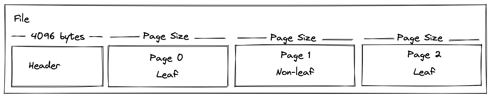
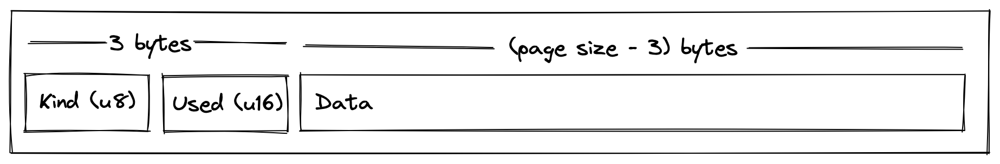
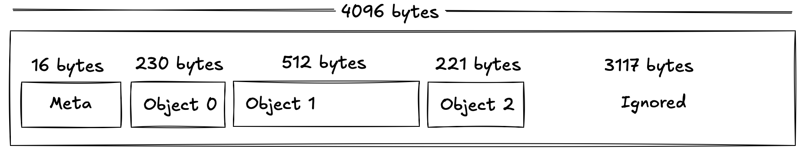
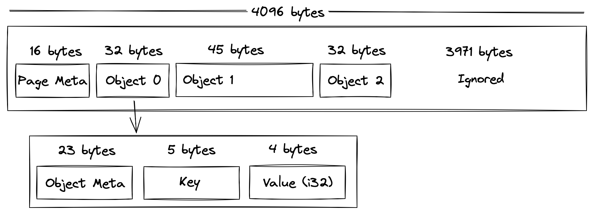
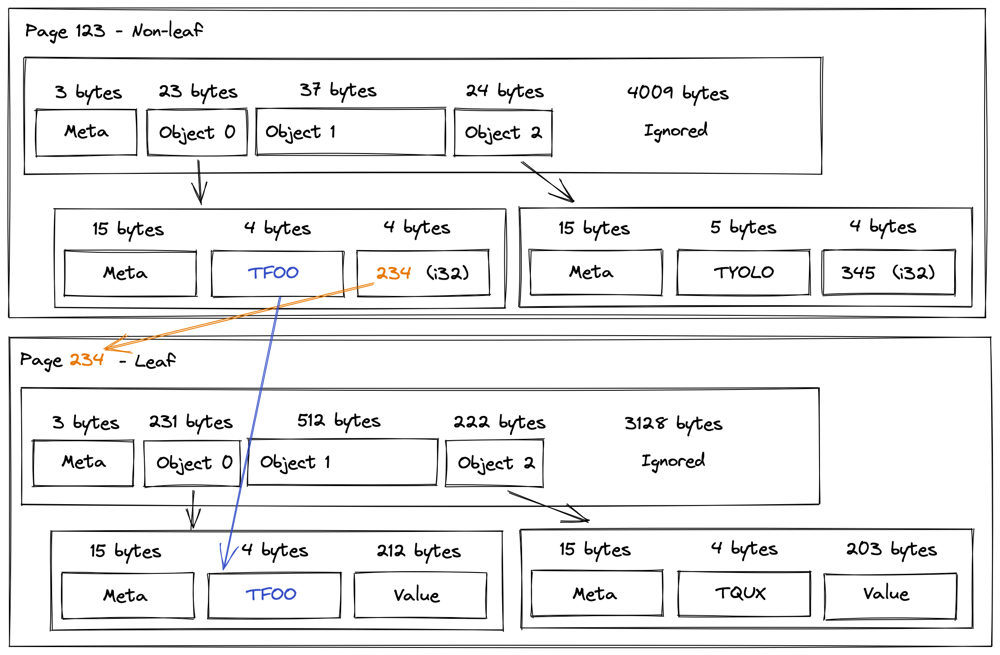
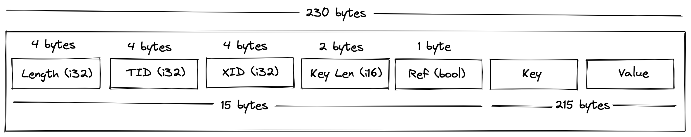
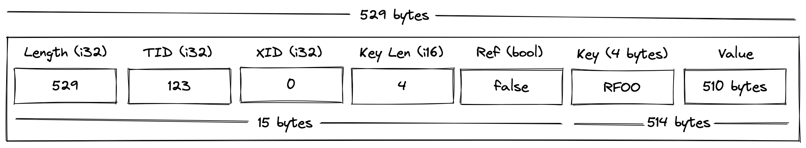
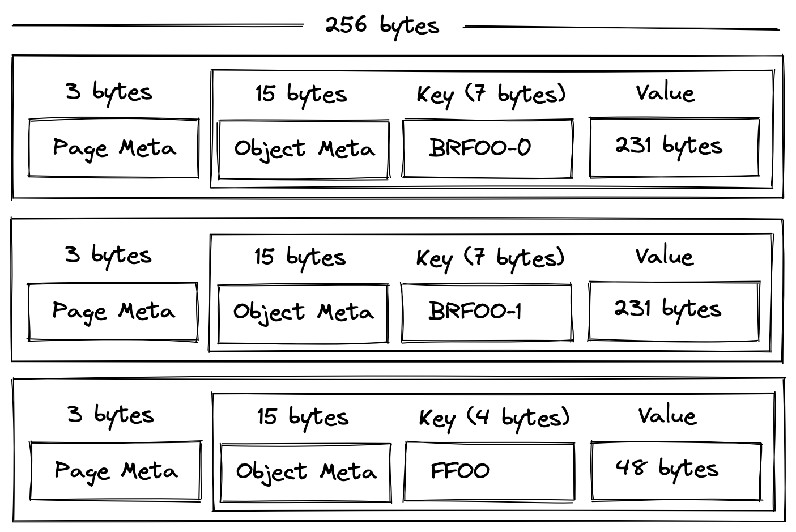
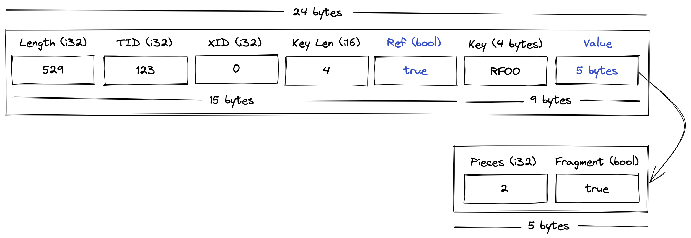

File Format
===========

.. contents::

Overview
--------

vsql stores the entire database (also known as the catalog) in a single file.
The default extension is ``.vsql``, although that is not required.

A second file, with the same name followed by ``.session``, is created next to
the database file. It is always empty and is only used for locking (see
:doc:`mvcc`). It can be deleted whenever there are no open connections to the
database.

The file must include a *Header*, followed by zero or more pages. That is, when
the database file is initially created it will only have a *Header* and zero
pages.

Every page must be the same size, but this is configurable. The page size cannot
be changed after the file is created (the page size is stored in the *Header*).

A page can be one of two types: leaf and non-leaf, and they may appear in any
order in the file. They may also be reordered or removed as the file expands and
contracts.

Also see :doc:`limitations`.

Header
------

The header is always 4kb (4096 bytes), regardless of the page size. Like the
rest of the file, all numbers are big-endian. Not all of this space is used, the
remaining space is reserved (see `Compatibility`_).

.. list-table::
  :header-rows: 1

  * - Offset
    - Part
    - Format
    - Description

  * - 0
    - *Magic*
    - 8 bytes
    - Always ``76 73 71 6c 0d 0a 1a 0a`` (``vsql\r\n\x1a\n``). Any file that
      does not start with these bytes is not a vsql database.

  * - 8
    - *Read Version*
    - u16 (2 bytes)
    - The oldest version of the file format that can read this file. See
      `Compatibility`_.

  * - 10
    - *Write Version*
    - u16 (2 bytes)
    - The oldest version of the file format that can change this file. See
      `Compatibility`_.

  * - 12
    - *Schema Version*
    - i32 (4 bytes)
    - Incremented whenever the schema changes, so that connections know when
      to reload it.

  * - 16
    - *Page Size*
    - i32 (4 bytes)
    - The size of every page, in bytes.

  * - 20
    - *Root Page*
    - i32 (4 bytes)
    - The page number (not including the header) of the root of the B-tree.

  * - 24
    - *Transaction ID*
    - i32 (4 bytes)
    - The last transaction ID that was issued.

  * - 28
    - *Row ID*
    - u64 (8 bytes)
    - The last row ID that was issued. Rows in a table without a ``PRIMARY
      KEY`` are keyed by a row ID. Row IDs are never reused.

  * - 36
    - *Active Transactions*
    - 256 x i32 (1024 bytes)
    - The IDs of the transactions that are in progress. Unused slots are 0.

  * - 1060
    - *Reserved*
    - 3036 bytes
    - Zero in this version of the file format. See `Compatibility`_.

Compatibility
-------------

The version of the file format that vsql reads and writes is 1. Before v1.0.0,
any change to the file format increases this version, and vsql will refuse to
open a file that uses an older version. You will need to recreate it.

From v1.0.0 the aim is that every version of vsql can open a file created by
an older version, and that most features don't need to change the file format
at all. The *Read Version* and *Write Version* in the `Header`_ work the same
way as the read and write versions of SQLite:

- If the *Read Version* is newer than the version of the file format that vsql
  supports, the file is refused. Some part of the file can't be understood.

- If the *Write Version* is newer, the file can be read but not changed. Any
  statement that changes the file returns a ``25006`` error. The file uses a
  feature that this version of vsql doesn't know how to keep correct, such as
  an index that wouldn't be updated when a row is inserted.

A new file has both set to the current version. A feature that needs a newer
version only raises them the first time it's used, so a file that never uses
the feature can still be read and changed by older versions of vsql.

These rules keep changes compatible:

1. The *Magic*, *Read Version* and *Write Version* never move, so that every
   version of vsql can check them.

2. New header fields go in the *Reserved* space, which is zero until a field is
   added. vsql writes the reserved space back exactly as it read it, so a field
   added by a newer version isn't lost when an older version changes the file.

3. Schema objects, such as tables, are stored as SQL (see `Schema Objects`_).
   Most features that add to a definition, such as ``DEFAULT`` or ``CHECK``,
   only need the SQL to be extended, rather than a new layout. An older version
   can't parse the new syntax, so using such a feature raises the *Read
   Version*.

4. Things that can be described separately from the object they belong to
   should be stored as their own objects, with a new key prefix (see
   `Object`_), rather than added to the existing definition. For example,
   constraints can be stored as ``ALTER TABLE ... ADD CONSTRAINT`` statements.
   Older versions ignore key prefixes they don't know about, so this only needs
   to raise the *Write Version* (or nothing at all, if it doesn't change how
   rows are written).

5. A change to how values are encoded, such as a new data type, must raise the
   *Read Version* when a table that uses it is created. Existing encodings
   never change.

Page
----

All pages types (defined by *Kind*) will use the same basic structure with 3
bytes reserved for metadata and the remaining bytes available for *Data*. The
format of the data itself will depend on the *Kind*:

.. list-table::
  :header-rows: 1

  * - Kind
    - Page Type

  * - 0
    - `Leaf Page`_

  * - 1
    - `Non-leaf Page`_

Since *Used* has a max value of 65536 this is also the maximum possible size
for a page. Although, the default page size for new files is 4096 bytes. [1]_

The *Used* includes the size of *Meta*. So an empty page would have a *Used* of
3 and an entirely full page would have a *Used* equal to the page size.

Leaf Page
---------

The first 3 bytes are reserved for *Meta*, which will contain the kind (``0``
for leaf) and the number of used bytes (remember that it also contains the
size of *Meta*).

The *Data* will contain zero or more objects. Although, zero objects is valid if
that were the case the page should be removed as part of the garbage collection.

Each `Object`_ may be variable length and can be any number of bytes so long as
the *Object* size is equal to or less than the (page size - 3). For objects that
cannot fit into a page, they are stored in as a `Blob Object`_ and referenced
from the *Object*.

Objects within a page are kept sorted by key and unused space is always located
after the used data. You should not assume that the unused portion is zeroed.

Non-leaf Page
-------------

A non-leaf page share a lot of similarities with a `Leaf Page`_. However, the
Objects are pointers to Leaf pages. That is the *Value* within the *Object* is a
i32 that references the `Leaf Page`_ number.

Objects within a non-leaf page are ordered based on the objects *Key*. This is
important for scanning (such as range queries) to improve performance as the
*Key* itself is the first *Key* in the referenced `Leaf Page`_. Here is an
example of how a `Non-leaf Page`_ references a `Leaf Page`_:

It's also important to note that as the B-tree gets larger, there may be
multiple non-leaf pages that need to be traversed this way. The process will
always end with a leaf page. A parent of a non-leaf (which must also be a
non-leaf) uses the *Key* that points to the first *Key* in the child page.

Object
------

An Object may be any length, but this example uses an object of 230 bytes:

Individual objects can be of different types and are encoded/decoded based on
the first byte of the *Key*. Objects with a first byte that isn't listed here
are ignored, so that new types of objects can be added (see
`Compatibility`_):

.. list-table::
  :header-rows: 1

  * - First Byte
    - Object Type

  * - ``B``
    - `Blob Object`_

  * - ``F``
    - `Fragment Object`_

  * - ``Q``
    - `Sequence Object`_

  * - ``R``
    - `Row Object`_

  * - ``S``
    - `Schema Object`_

  * - ``T``
    - `Table Object`_

  * - ``V``
    - `Sequence Value Object`_

Every object contains 15 bytes of metadata:

.. list-table::
  :header-rows: 1

  * - Part
    - Format
    - Description

  * - *Length*
    - i32 (4 bytes)
    - Is the total length of the object (including the metadata).

  * - *TID*
    - i32 (4 bytes)
    - Transaction ID that created this object. [2]_

  * - *XID*
    - i32 (4 bytes)
    - Transaction ID that expired this object. [2]_

  * - *Ref*
    - u8 (1 byte)
    - When ``true``, the *Value* will be 5 bytes containing. See `Blob Object`_.

  * - *Key Len*
    - i16 (2 bytes)
    - The number of bytes in the proceeding *Key*.

Using this metadata we can say that the length of *Value* will be: (*Length* -
15 - *Key Length*).

Blob Object
-----------

When an object is added to the B-tree that is too large to fit into a single
page, it must be split into *blob* (B) and *fragment* (F) objects. For example,
if the page size was 256 bytes, but we try to insert a object that is 529 bytes:

It is split into 3 objects:

Where entire pages consist of one more blob objects followed by an optional
fragement object containing any left over data. The fragment is optional because
the object might happen to fit perfectly in a whole number of blob objects.

Finally, the original object is replaced with a reference (blue indiciated
replacements):

Fragment Object
---------------

A fragment object (uses the prefix ``F``) contains a portion of data from
splitting a large object. See `Blob Object`_.

Row Object
----------

A Row Object (has the ``R`` prefix) contains a table row. The serialization does
not need to be explained in detail here. You can check the code for
``Row.bytes()`` and ``new_row_from_bytes()`` respectively.

Schema Objects
--------------

The definition of each schema, sequence and table is stored as the SQL
statement that would create it, like SQLite does. When the file is opened, the
statements are parsed to rebuild the schema in memory.

The SQL is written so that it means the same thing in any version of vsql:

- Every name is a delimited identifier (``"PUBLIC"."FOO"``), so it isn't
  affected by case folding or by new reserved words.

- Names don't include the catalog, since the catalog is the file itself.

- Data types are written in full, such as ``TIMESTAMP(0) WITHOUT TIME ZONE``,
  rather than relying on defaults.

Schema Object
-------------

A Schema Object (has the ``S`` prefix) contains a schema definition, as a
``CREATE SCHEMA`` statement:

.. code-block:: sql

  CREATE SCHEMA "PUBLIC"

Sequence Object
---------------

A Sequence Object (has the ``Q`` prefix) contains the definition for a sequence
(not including the next value, see `Sequence Value Object`_), as a ``CREATE
SEQUENCE`` statement:

.. code-block:: sql

  CREATE SEQUENCE "PUBLIC"."SEQ1"
    INCREMENT BY 5
    MINVALUE 10

Sequence Value Object
---------------------

A Sequence Value Object (has the ``V`` prefix) contains the next value for a
sequence. Since a sequence's next value needs to be atomic, even outside of
transaction isolation, changing the value will be always persistent.

Table Object
------------

A Table Object (has the ``T`` prefix) contains a table definition, as a
``CREATE TABLE`` statement:

.. code-block:: sql

  CREATE TABLE "PUBLIC"."FOO" (
    "ID" INTEGER NOT NULL,
    "BAR" CHARACTER VARYING(10),
    PRIMARY KEY ("ID")
  )

Notes for Future Improvements
-----------------------------

Sequences
^^^^^^^^^

The properties of a sequence (such as the ``INCREMENT BY``, etc) are held in the
same record as the next value. Since the next value of a sequence needs to be
atomic (and separate from the transaction isolation) a ``ROLLBACK`` on a
transaction that contains an ``ALTER SEQUENCE`` will not undo any changes.

Ideally, the properties of a ``SEQUENCE`` can be stored in a separate location
on disk.

Notes
-----

.. [1] See ``default_connection_options()`` in
   https://github.com/elliotchance/vsql/blob/main/vsql/connection.v.

.. [2] This is used for transaction visibility. See :doc:`mvcc`.
